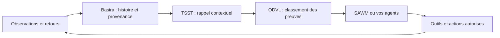

# SAWM × Basira

### La mémoire liquide pour une IA qui se souvient, s'adapte et agit.

Développez des agents spécialisés avec une continuité, un caractère évolutif et des décisions traçables.

[**Basira Cloud**](https://basira.sawm.io) · [**Documentation API**](https://basira.sawm.io/documentation) · [**SAWM**](https://sawm.io) · [**English**](https://github.com/SAWM-io/.github/blob/main/profile/README.md)

---

## Donner à l'intelligence une histoire qu'elle peut utiliser

Une organisation a besoin d'agents capables de poursuivre un travail : conserver une contrainte, retrouver une source, tenir compte d'une correction et reprendre le dossier d'un collègue autorisé.

**SAWM est notre plateforme d'agents. Basira en constitue le socle de mémoire liquide, également accessible à vos propres agents par l'API Cloud.** Ensemble, ils relient conversations, documents et événements dans un contexte qui se poursuit : ce qui était connu, ce qui a changé, la décision prise et le retour obtenu.

Ce socle apporte davantage qu'un stockage de texte : **travail spécialisé, connaissance partagée dans l'organisation, personnages d'IA évolutifs et décisions éclairées par l'expérience enregistrée.**

## Ce que votre organisation peut construire

| Domaine | Un usage concret |
|---|---|
| **Cyberdéfense agentique** | Relier les événements d'un serveur, enquêter sur une activité suspecte, proposer un confinement, appliquer les autorisations locales et vérifier le résultat. |
| **Agents métier spécialisés** | Coordonner comptabilité, audit, juridique ou IT autour de dossiers autorisés, avec leurs sources, révisions et transmissions entre collègues. |
| **Sécurité et gouvernance** | Séparer les accès par rôle et entité, partager certaines mémoires et examiner les actions enregistrées avec leurs preuves. |
| **Jeux vidéo et mondes virtuels** | Créer des PNJ qui se souviennent des rencontres, font évoluer leurs attitudes et conservent relations et engagements entre les sessions. |
| **Télécommunications et réseaux** | Explorer la livraison adaptative, le changement de chemin et la répartition de charge, avec des expériences reproductibles et des résultats mesurés. |
| **Robotique et assistants de service** | Relier observations, historique d'interaction, préférences et résultats des actions à la prochaine tâche autorisée. |
| **Commerce agentique** | Donner aux agents des outils pour rechercher, comparer, négocier et coordonner des achats en conservant les préférences et engagements pertinents. |

Ce sont des pistes d'intégration. Chaque démonstrateur précise ses fonctionnalités, les conditions testées et les raccordements nécessaires à son déploiement dans un environnement donné.

## Mémoire, caractère et contexte émotionnel

**Un caractère qui évolue a besoin d'un passé.** Un joueur qui revient doit pouvoir retrouver un personnage qui se rappelle leur rencontre précédente. Un assistant professionnel doit pouvoir conserver une préférence explicitement exprimée, puis la réviser lorsque l'utilisateur change d'avis.

Reliez la mémoire au programme qui pilote l'agent pour conserver :

- **L'identité et le caractère :** un rôle suivi, des préférences et des traits.
- **Le contexte émotionnel :** des états modélisés d'humeur, de prudence, de confiance et d'interprétation des relations.
- **L'expérience :** rencontres, réussites, échecs, corrections et leurs sources.
- **La continuité :** un comportement qui peut tenir compte de l'histoire accumulée entre les sessions.

C'est la base d'un **ressenti d'interaction plus cohérent** : ce qui se passe aujourd'hui peut compter demain. Les traits et états émotionnels sont des représentations informatiques, pas une preuve de sentiments subjectifs ni une mesure des émotions intérieures d'une personne. Le modèle et l'application déterminent leur effet sur le comportement ; le kit mémoire ne génère pas à lui seul une personnalité.

## Les technologies qui portent cette continuité

| Composant | Son rôle |
|---|---|
| **SAWM** | Les parcours d'agents, les outils et la coordination dans les autorisations de l'application. |
| **Basira** | La mémoire évolutive, l'historique, la provenance et les contextes gouvernés. |
| **TSST** | Le rappel de preuves pertinentes selon les dimensions sémantiques, temporelles et contextuelles, après contrôle des droits. |
| **ODVL** | Le reclassement des preuves entre l'activité courante et les fondations de la mémoire, sans ajouter ni retirer de preuve, ni en établir la vérité. |

Les corrections peuvent conserver les versions précédentes. Le rappel temporel et le flashback permettent de revenir aux preuves disponibles à une date de coupure. La provenance distingue observation, information rapportée et inférence. Les scopes et droits par entité définissent les agents autorisés à lire ou contribuer.

## Explorer les projets publics

| Projet | Point de départ |
|---|---|
| [**Liquid Memory**](https://github.com/SAWM-io/liquid-memory) | Mondes, flashback, révisions, personnages évolutifs et intégration d'une mémoire partagée. |
| [**Cyber Defense Agentique**](https://github.com/SAWM-io/cyber-defense-agentique-sawm-basira) | Observation Linux, mémoire Cloud, décisions autorisées et résultats auditables. |
| [**SAWM Anti-Brouillage**](https://github.com/SAWM-io/sawm-anti-brouillage) | Livraison résiliente, démonstration VM vers Mac et preuves du simulateur ODVL d'origine. |
| [**SAWM Smart Réseau**](https://github.com/SAWM-io/sawm-smart-reseau) | Comparaison de la moyenne glissante et d'ODVL pour des expériences de répartition de charge. |
| [**SAWM Agent Kit**](https://github.com/SAWM-io/sawm-agent-kit) | Connexion de votre propre modèle aux outils authentifiés de SAWM. |

Les projets réseau distinguent simulation numérique, transport IP réel et intégration Cloud. Ces essais ne mesurent pas une résistance au brouillage radio physique.

## Construire avec nous

Partez d'un exemple public, raccordez **votre environnement Basira / SAWM Cloud autorisé** et évaluez-le sur votre propre activité. Conservez les secrets côté serveur, limitez les droits aux dossiers concernés et vérifiez les effets des actions.

Les dépôts publics contiennent du code d'intégration, des exemples et des preuves. Les moteurs privés SAWM, Basira, TSST et ODVL n'y sont pas distribués. Chaque dépôt précise sa licence et ses dépendances.

---

**Une mémoire qui garde le fil. Une intelligence qui peut s'appuyer sur l'expérience.**

[Basira Cloud](https://basira.sawm.io) · [Développeurs](https://basira.sawm.io/documentation) · [SAWM](https://sawm.io)

Luxembourg · contact@sawm.io

