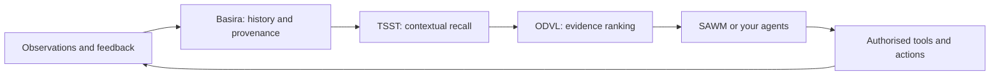

# SAWM × Basira

### Liquid memory for AI that remembers, adapts and acts.

Build specialised agents with continuity, evolving character and traceable decisions.

[**Basira Cloud**](https://basira.sawm.io) · [**API documentation**](https://basira.sawm.io/documentation) · [**SAWM**](https://sawm.io) · [**Français**](https://github.com/SAWM-io/.github/blob/main/profile/README.fr.md)

---
## 98,4 % – 98,6 % sur LongMemEval-S
## Give intelligence a history it can use

An organisation needs its agents to carry a task forward: remember a constraint, revisit a source, recognise a correction and pick up where another authorised colleague left off.

**SAWM is our agent platform. Basira is its liquid-memory foundation, also available to your own agents through the Cloud API.** Together, they connect conversations, documents and events into a continuing context: what was known, what changed, what was decided and what happened afterwards.

This gives developers a foundation for more than stored text: **specialised work, shared organisational knowledge, evolving AI characters and decisions grounded in recorded experience.**

## What your organisation can build

| Domain | A concrete use |
|---|---|
| **Agentic cyberdefense** | Relate server events, investigate suspicious activity, propose containment, enforce local authorisations and check the result. |
| **Specialised enterprise agents** | Coordinate accounting, audit, legal or IT work around authorised dossiers, with sources, revisions and a clear handover. |
| **Security and governance** | Separate access by role and entity, share selected memories, and review recorded actions and supporting evidence. |
| **Gaming and virtual worlds** | Create NPCs that remember encounters, develop attitudes and carry relationships and commitments across play sessions. |
| **Telecommunications and networks** | Explore adaptive delivery, failover and load balancing with replayable experiments and measured outcomes. |
| **Robotics and service assistants** | Connect observations, interaction history, preferences and action outcomes to an agent's next authorised task. |
| **Agentic commerce** | Give agents tools to search, compare, negotiate and coordinate purchases while retaining relevant preferences and commitments. |

These are integration paths. Each demonstrator documents what it implements, the conditions tested and the work required for deployment in a particular environment.

## Memory, character and emotional context

**An evolving character needs a past.** A returning player should be able to meet a character that remembers their previous encounter. A work assistant should be able to retain an explicitly stated preference and revise it when the user changes their mind.

Connect memory to an agent runtime to carry forward:

- **Identity and character:** a continuing role, preferences and traits.
- **Emotional context:** modeled moods, caution, confidence and interpretations of relationships.
- **Experience:** encounters, successes, failures, corrections and their sources.
- **Continuity:** behaviour that can respond to accumulated history across sessions.

This is the foundation for a more coherent **feeling of interaction**: what happens today can matter tomorrow. Traits and emotional states are computational representations; they are not proof of subjective feelings or a measurement of a person's inner emotions. The model and application determine how these states affect behaviour; the memory kit alone does not generate personality.

## The technology behind the continuity

| Component | Its role |
|---|---|
| **SAWM** | Agent workflows, tools and coordination within the permissions of the application. |
| **Basira** | Evolving memory, history, provenance and governed contexts. |
| **TSST** | Retrieve relevant evidence across semantic, temporal and contextual dimensions, after access checks. |
| **ODVL** | Re-rank memory evidence between current activity and deeper foundations, without adding or removing evidence, or establishing its truth. |

Corrections can retain their earlier history. Time-aware retrieval and flashback help revisit the evidence available at a chosen cutoff. Provenance keeps observations, reported information and inferences distinguishable. Access scopes and entity grants define which agents may read or contribute.

## Explore the public projects

| Project | Start here |
|---|---|
| [**Liquid Memory**](https://github.com/SAWM-io/liquid-memory) | Worlds, flashback, revisions, evolving characters and shared-memory integration. |
| [**Agentic Cyber Defense**](https://github.com/SAWM-io/cyber-defense-agentique-sawm-basira) | Linux observation, Cloud-backed memory, authorised decisions and auditable outcomes. |
| [**SAWM Anti-Brouillage**](https://github.com/SAWM-io/sawm-anti-brouillage) | Resilient delivery, a live VM-to-Mac demonstration and original ODVL simulation evidence. |
| [**SAWM Smart Réseau**](https://github.com/SAWM-io/sawm-smart-reseau) | Moving-average and ODVL comparisons for adaptive load-balancing experiments. |
| [**SAWM Agent Kit**](https://github.com/SAWM-io/sawm-agent-kit) | Connect your own model and runtime to SAWM's authenticated tools. |

The network projects distinguish numerical simulation, real IP transport and Cloud integration. These trials do not measure resistance to physical radio jamming.

## Build with us

Start from a public example, connect **your authorised Basira / SAWM Cloud environment**, and evaluate it on your own workload. Keep credentials server-side, scope access to the intended dossiers and verify the effects of actions.

Public repositories contain integration code, examples and evidence. The private SAWM, Basira, TSST and ODVL engines are not distributed in these repositories. Each repository states its own licence and dependencies.

---

**Memory that carries forward. Intelligence that can build on experience.**

[Basira Cloud](https://basira.sawm.io) · [Developers](https://basira.sawm.io/documentation) · [SAWM](https://sawm.io)

Luxembourg · contact@sawm.io

